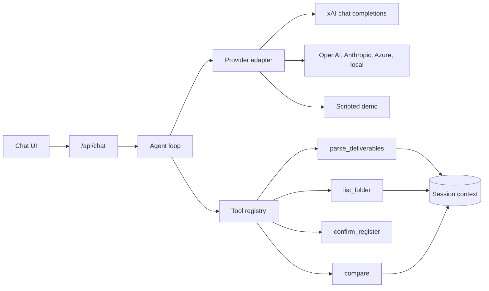

# GEG deliverables assistant

A chat assistant for an engineering document check. The person talks to the bot, hands it a deliverables register, confirms what the bot understood, then shares a folder. The bot checks every deliverable with a deterministic tool: extensions are ignored, a different revision is flagged with the expected and found values, and missing or extra files are listed. The result is a table that exports to Excel or CSV.

The conversation is the screen. Scope can grow by adding tools; the checks that exist today are tools the model calls, not special cases buried in the UI.

The sample files in `samples/` are synthetic. Do not commit a real client register or a real transmittal folder.

## Stack

- Next.js (App Router) and React, one Node process
- TypeScript
- [SheetJS](https://docs.sheetjs.com/) (`xlsx`) to read registers and write the Excel export
- `unpdf` to read text out of a PDF register
- Vitest for the parser, the matcher, the scripted demo, and the live tool-calling adapter

Run it locally with `npm.cmd` so PowerShell does not block `npm.ps1`.

## Run on Windows

In PowerShell, from this folder:

```powershell
copy .env.example .env.local
npm.cmd install
npm.cmd run dev
```

Open http://localhost:3000 and click **Run demo**. That walkthrough uses the synthetic register and a synthetic folder. It does not call a model.

`npm.cmd run dev` is the local command. `npm.cmd test` runs the tests. `npm.cmd run build` then `npm.cmd start` runs the production server.

On macOS or Linux the same scripts are `npm install` and `npm run dev`.

Sessions live in memory and reset when the server stops.

## Configuration

`.env.local` is gitignored. Start from `.env.example`.

With no API key the app stays in **demo mode**: the same tools run, and a scripted assistant decides which tool to call and writes the reply in the user's language (Portuguese or English). Set `GEG_DEMO_MODE=true` to force that even when a key is present. The **Run demo** button always uses the script, so the guided tour does not spend tokens.

xAI is the default provider. The API is OpenAI-compatible.

```env
LLM_PROVIDER=xai
LLM_MODEL=grok-4.7
LLM_BASE_URL=https://api.x.ai/v1
LLM_API_KEY=your-key
```

`XAI_API_KEY` is also read when `LLM_API_KEY` is empty. The model needs tool calling. Restart `npm.cmd run dev` after changing the file.

`LLM_TIMEOUT_MS` is how long one model call may take before the chat shows the error (default 35 seconds). A slow or failed model does not leave the screen on "Checking…". The register is parsed first, and the context panel updates as soon as that read finishes.

| Provider | `LLM_PROVIDER` | Endpoint |
| --- | --- | --- |
| xAI (default) | `xai` | `https://api.x.ai/v1` |
| OpenAI | `openai` | `https://api.openai.com/v1` |
| Anthropic | `anthropic` | `https://api.anthropic.com` |
| Azure OpenAI | `azure` | `AZURE_OPENAI_ENDPOINT` + `AZURE_OPENAI_DEPLOYMENT` + `AZURE_OPENAI_API_VERSION` |
| Any OpenAI-compatible or local server (Ollama, LM Studio, …) | `openai-compatible` | `LLM_BASE_URL`, for example `http://127.0.0.1:11434/v1` |

Azure uses the `api-key` header and this path:

`{endpoint}/openai/deployments/{deployment}/chat/completions?api-version=2024-10-21`

Anthropic uses the Messages API. Every other provider uses chat completions.

## What the first version does

1. Chat in Portuguese or English. The bot answers in the language of the latest message. You can attach a register in the composer.
2. When a register arrives (`.xlsx`, `.xls`, `.csv`, or `.pdf`), `parse_deliverables` reads it and the bot says what it understood:
   - sheets, and which ones are code lists versus the deliverable register
   - the header row (a real register often has it around row 11)
   - the column that holds the document numbers (often `Drawing Numbering`)
   - the naming pattern `Region-Asset-Contract-Org-Discipline-DocType-{SheetType}{Chapter}{Serial}_{Rev}`
   - how many deliverables it found, skipping section rows such as `FOLDER 01 - BOOK 01`
   It then asks you to confirm or correct it. That understanding stays on the session and in the context panel. A correction such as "the column is Drawing Numbering and the header is row 11" parses the file again. "Yes, that's correct" / "Sim, está correto" confirms it.
3. Share a folder with the browser's folder picker, or paste filenames. A register and a folder in the same message are parsed and then compared, without waiting for a second turn. Only filenames leave the browser for a folder share; the register file itself is uploaded so it can be read. `list_folder` stores the names and `compare` checks them:
   - extensions ignored (`.pdf`, `.PDF`, `.dwg`, …)
   - same identity, different `_Rev` → wrong revision, expected versus found
   - no file for that identity → missing
   - a file that matches no deliverable → extra
   The chat gets a short summary and a table. Export CSV or Excel from the table. CSV is written with a UTF-8 BOM so Excel on Windows keeps accents.

A codes sheet of name/code pairs (Region, Asset, Contract, Organization, Discipline, Document type, Sheet type, Chapter) is kept as context and, when the codes have a fixed width, used to split the tail of the number into sheet type, chapter, and serial.

PDF registers are read as text. The bot will say so and ask you to confirm, because a PDF does not keep the spreadsheet row.

## Demo data

`samples/synthetic-register.xlsx` is a small stand-in for the real shape: a Codes sheet, a Register sheet whose header is row 11, section rows like `FOLDER 01 - BOOK 01`, and numbers such as `05-732800-4200000103-BOF-SUS-RPT-000002_E`. `samples/synthetic-folder.txt` is the matching filename list, including a wrong revision, two missing numbers, and three extra files. Nothing in `samples/` is client data.

Regenerate them with `npm.cmd run generate-samples`. The parser is also tested against a 1,700-row sheet so a full register stays fast.

## Architecture



- `src/lib/llm/` is the provider adapter. It speaks one internal shape: messages plus tool calls. `openaiCompatible.ts` covers xAI, OpenAI, Azure OpenAI, and any other chat-completions server. `anthropic.ts` translates the same shape to the Messages API. `scripted.ts` is the demo brain: it chooses tools from the conversation and writes the reply from the tool result, in Portuguese or English.
- `src/lib/agent/loop.ts` calls the provider, runs tools, and feeds the results back. In live mode a register or folder is read before the model is called, and the model receives a short summary (counts, pattern, a few samples, a few issues), not the sheet. The system prompt in `src/lib/agent/prompt.ts` carries the session snapshot. `/api/chat` streams progress, each tool result, and the context panel as newline-delimited JSON, then the finished transcript.
- `src/lib/tools/` is the registry. Tools do the work. The model does not invent counts.
- `src/lib/parse/` and `src/lib/match/compare.ts` are pure functions with tests. The tools are thin wrappers that store the result on the session.
- `src/lib/session/store.ts` keeps the register understanding, the folder names, the comparison, and the transcript in memory.

## Add a tool

1. Add a module next to the others, for example `src/lib/tools/echoNote.ts`:

```ts
import { registerTool } from "./registry";

registerTool({
  name: "echo_note",
  description: "Store a short note on the session when the user asks you to remember one.",
  parameters: {
    type: "object",
    properties: {
      note: { type: "string", description: "The note to remember." },
    },
    required: ["note"],
    additionalProperties: false,
  },
  execute(args) {
    const note = String(args.note ?? "");
    return { ok: true, summary: `Noted ${note.length} characters`, data: { note } };
  },
});
```

2. Import it from `src/lib/tools/index.ts` so it registers at startup:

```ts
import "./echoNote";
```

3. Mention the new tool in `src/lib/agent/prompt.ts` if the model needs to know when to call it. The adapter publishes whatever is registered, so OpenAI-compatible providers and Anthropic both see it. The scripted demo only calls tools it knows about; extend `src/lib/llm/scripted.ts` if the demo should use the new tool too.

4. Cover the pure logic with a Vitest file under `tests/` when the tool does more than pass a string through.

## Tests

```powershell
npm.cmd test
```

Covers header-row and column detection, code lists, the naming pattern, a 1,700-row register, PDF text, revision mismatches (expected versus found), missing and extra files, the scripted PT/EN demo through the API, and a live OpenAI-compatible round trip: a 1,700-row register plus a folder in one Portuguese message, a compact model payload, and a model call that never answers.
